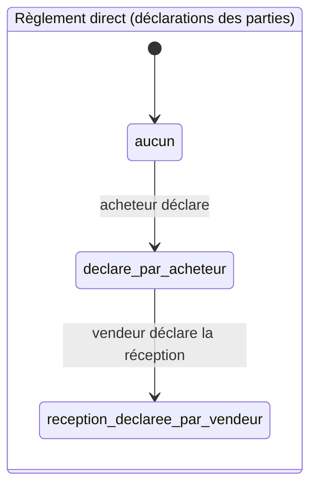
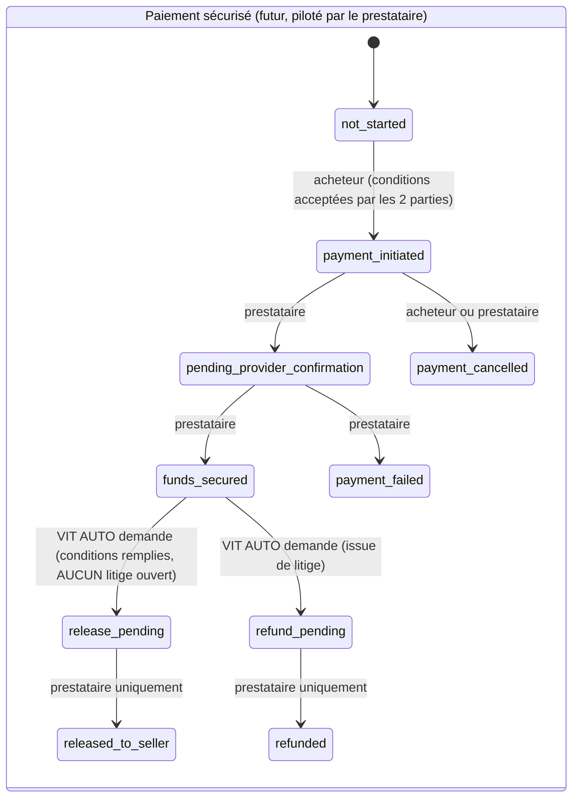
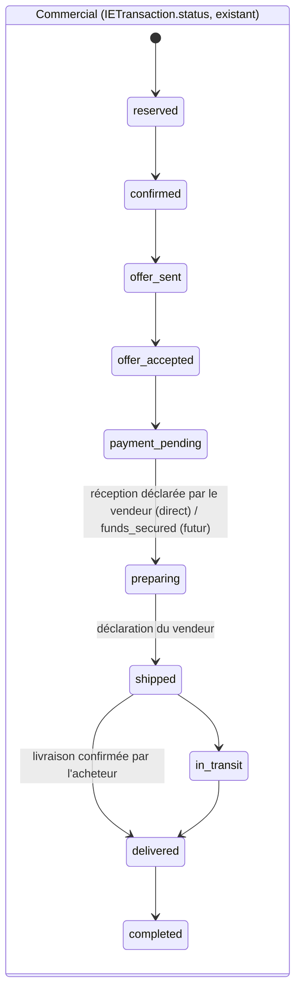
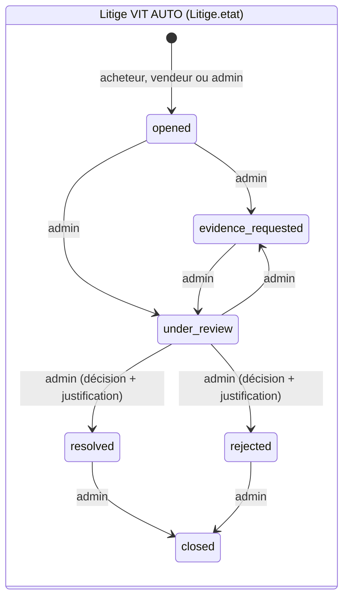
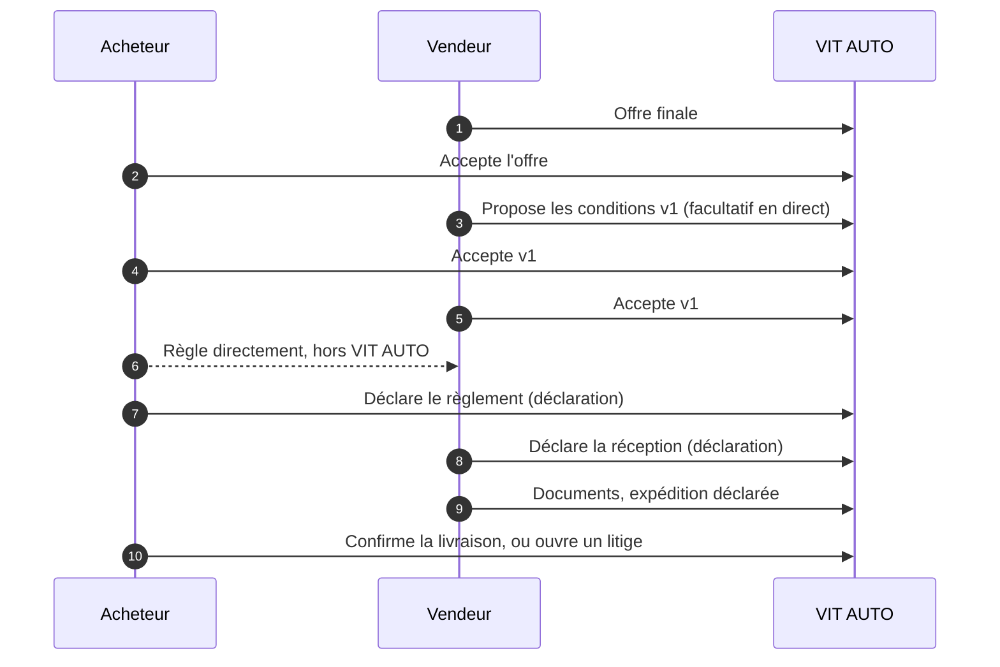
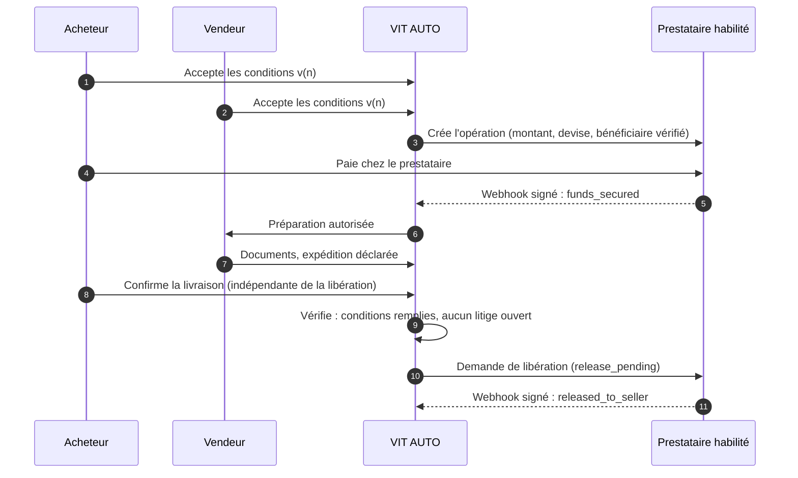

# Paiements, séquestre et litiges : audit, sécurisation et modèle cible

Établi le 2026-10-31 à partir des consignes « Rappel stratégique » et « Urgence paiements, séquestre et
litiges » de l'exploitant.

**Décision cible :** séquestre tenu par un prestataire habilité, suivi orchestré par VIT AUTO,
**aucune détention de fonds par VIT AUTO** tant que le cadre juridique, contractuel et opérationnel
n'est pas validé.

Rien de ce qui suit n'active de paiement, ne simule de séquestre et ne déplace de fonds.

Sommaire (livrables demandés) :
1. [État des lieux technique](#1-état-des-lieux-technique)
2. [Fichiers et composants concernés](#2-fichiers-et-composants-concernés)
3. [Cartographie des paiements actuels](#3-cartographie-des-paiements-actuels)
4. [Analyse des risques](#4-analyse-des-risques)
5. [Sécurisation immédiate](#5-sécurisation-immédiate)
6. [Textes de séquestre : trouvés, corrigés, non corrigés](#6-textes-de-séquestre)
7. [Modèle de données](#7-modèle-de-données)
8. [Statuts et transitions](#8-statuts-et-transitions)
9. [Parcours de paiement](#9-parcours-de-paiement)
10. [Parcours de litige](#10-parcours-de-litige)
11. [Conditions de libération versionnées](#11-conditions-de-libération-versionnées)
12. [Tests réalisés et résultats](#12-tests-réalisés-et-résultats)
13. [Décisions à valider (humaine ou juridique)](#13-décisions-à-valider)
14. [Prérequis pour activer un prestataire de séquestre](#14-prérequis-prestataire)

---

## 1. État des lieux technique

- **Interrupteur général** : `PAYMENTS_ENABLED`, lu par `server/config/featureFlags.js`. Il est
  **fermé en production** (`GET /api/pricing/config` → `paymentsEnabled: false`, lu une fois le
  2026-10-31). Aucun paiement en ligne ne peut donc être initié aujourd'hui en production. Le
  risque est **latent** : passer la variable à `true` suffisait à rouvrir tous les encaissements.
- **Séquestre Import/Export maison** : fermé côté serveur depuis le 2026-10-30
  (`IE_ESCROW_ENABLED`, 503 `SEQUESTRE_SUSPENDU` sur paiement, solde, vérification et libération).
  Le règlement direct déclaratif est en place (`docs/sequestre.md`).
- **Moyens propres à la location** : location, loisirs, chauffeur et pièces sont réglés **en espèces,
  directement au partenaire** (`server/constants/paiement.js`, appliqué par `createBooking`). Ils ne
  passent jamais par un compte VIT AUTO.
- **Restent payables en ligne quand l'interrupteur est ouvert** : réservations de type `essai`
  et `leasing` (les ventes passent par la demande d'essai), devis de services (`ServiceRequest`) et primes d'assurance
  (`InsuranceRequest`), tous par `POST /api/payments/initiate`.
- **Bénéficiaire** : le compte marchand **de VIT AUTO**, pour les quatre prestataires branchés. Il
  n'existe ni compte vendeur, ni paiement fractionné, ni séquestre chez un prestataire. Le
  partenaire serait réglé à part (`Booking.partnerPayout`, onglet admin « Reversements »).
- **Production** : la base n'est pas joignable depuis ce poste (DNS de MongoDB Atlas en échec). La
  liste des situations en cours (§5.3) reste à tirer avec le script en lecture seule prévu.

## 2. Fichiers et composants concernés

| Domaine | Fichiers |
|---|---|
| Interrupteurs | `server/config/featureFlags.js`, `src/config/featureFlags.js`, `server/scripts/apiLocale.mjs`, `server/tests/setup.js` |
| Initiation des paiements | `server/controllers/paymentController.js` (`initiatePayment`, `createPayment`, `simulatePayment`), `server/services/payment/gateway.js` |
| Prestataires | `server/services/payment/providers/{stripe,wave,orangeMoney,paydunya,simulated}Provider.js` |
| Webhooks | `paymentController.js` (`stripeWebhook`, `waveWebhook`, `orangeMoneyWebhook`, `paydunyaWebhook`), `server/server.js` (corps bruts, `webhookLimiter`) |
| Remboursements | `server/services/payment/refundService.js`, appelé par `bookingController.js` (annulations) et `refundPaymentAdmin` |
| Reversements et commissions | `Booking.partnerPayout`, `server/models/CommissionLedger.js`, `server/controllers/commissionLedgerController.js` |
| Import/Export | `server/models/IETransaction.js`, `server/controllers/ieTransactionController.js`, `server/routes/importExport.js`, `src/pages/IETransactionTracking.jsx` |
| Logistique | `server/models/DemandeLogistique.js`, `server/models/DossierImport.js`, `logistiqueController.js`, `dossierImportService.js`, `transitController.js` |
| Abonnements (revenu propre de VIT AUTO) | `server/controllers/subscriptionController.js` |
| Écrans de paiement | `src/pages/Booking.jsx`, `Dashboard.jsx`, `ServiceRequest.jsx`, `ActivityBooking.jsx` |

## 3. Cartographie des paiements actuels

| Fournisseur | Encaissement actuel | Bénéficiaire | Transfert partenaire | Remboursement | Risque |
|---|---|---|---|---|---|
| **Stripe** (carte, Checkout) | Possible si `STRIPE_SECRET_KEY` et `PAYMENTS_ENABLED` ; jamais ouvert en production | Compte Stripe de VIT AUTO (pas de Connect, ni `transfer_data` ni `application_fee`) | Aucun automatique ; reversement manuel hors plateforme | Automatique, total ou partiel (`stripeProvider.refund`) | **Élevé** : encaissement pour compte de tiers |
| **Wave** (Checkout) | Idem, `WAVE_API_KEY` | Compte marchand Wave de VIT AUTO | Aucun automatique | Automatique, total seulement ; manuel sinon | **Élevé** |
| **Orange Money** (Web Payment) | Idem, identifiants OM | Compte marchand OM de VIT AUTO | Aucun automatique | Manuel | **Élevé** ; callbacks non signés (protégés par un jeton par paiement) |
| **PayDunya** (agrégateur : carte et mobile money) | Prioritaire dès qu'il est configuré, en `live` en production | Compte PayDunya de VIT AUTO | Aucun automatique | Manuel | **Élevé** |
| **Simulé** | Développement et vérification locale ; fermé en production sauf `PAYMENTS_SIMULATION=true` | — | — | — | Faible ; ne doit jamais être ouvert en production |
| **Stripe Import/Export** (`payEscrow`) | Fermé (séquestre suspendu) | Compte Stripe de VIT AUTO | Ancienne « libération » admin, désormais refusée | — | Neutralisé |
| **Virement, LC, mobile money manuel (IE)** | Fermé (séquestre suspendu) | Le compte qui recevait les virements n'est pas dans le code | — | — | Neutralisé |

Aucune intégration de type marketplace, paiement fractionné, séquestre ou paiement conditionnel
n'existe dans le code. Ce que prévoient les **comptes et contrats** souscrits chez ces prestataires
reste à vérifier par l'exploitant : le code ne peut pas le dire.

## 4. Analyse des risques

1. **Encaissement pour compte de tiers** dès l'ouverture de `PAYMENTS_ENABLED`, sur les
   essais, leasings, services et assurances. **Corrigé** (§5.1) : une seconde clé serveur, fermée,
   est désormais exigée.
2. **Promesses de séquestre en production** sur l'accueil et la page « Pourquoi », dans les 5
   langues. **Corrigé** (§6).
3. **Remboursements automatiques à l'annulation** (`bookingController`, annulation par le client ou
   le partenaire) : ils remboursaient réellement un paiement Stripe ou Wave complété, sans décision
   humaine. **Corrigé** (§5.4) : plus aucune décision automatique tant que l'encaissement pour tiers
   est fermé.
3 bis. **Remboursement « manuel » marqué remboursé avant tout versement** : quand le prestataire ne
   rembourse pas par API, `refundService` passe déjà le paiement à `refunded` et annonce au client
   « remboursement en cours ». C'est une déclaration et non une confirmation. **À reprendre** avec le
   futur modèle (`refund_pending`, puis `refunded` à la confirmation du prestataire). Ce cas est
   inerte aujourd'hui : aucun paiement en ligne n'est encaissé.
4. **Un seul champ `status` IE** mêle commercial, paiement et logistique ; un litige **écrase** le
   statut commercial (`openDispute` → `disputed`). Il faut le refondre (§7 et §8) avant le
   séquestre réel.
5. **Pas de journal d'événements de webhook** : l'idempotence repose sur l'état de l'objet
   (suffisante aujourd'hui, mais insuffisante pour un séquestre).
6. **Écrans de réservation (essai, leasing)** : ils proposent carte, Orange Money et Wave,
   alors que le serveur refuse. La réservation est conservée et un message d'échec s'affiche ; c'est
   désormais **masqué** côté écran (§5.2).
7. **Double commission entre canaux** (lead d'essai + transaction IE sur la même vente) : faible,
   à couvrir dans le futur modèle.

## 5. Sécurisation immédiate

### 5.1 Blocage serveur

`ENCAISSEMENT_TIERS_AUTORISE` (variable d'environnement, **absente = fermé**), lue à chaque appel
par `encaissementPourTiersOuvert()` (`server/config/featureFlags.js`).

- `POST /api/payments/initiate` répond 503 `ENCAISSEMENT_TIERS_SUSPENDU` pour toute cible
  (réservation, devis de service, prime d'assurance), **même si `PAYMENTS_ENABLED=true`**. Aucun
  `Payment` n'est créé.
- Ce qui reste ouvert : création de réservation, demandes d'achat, échanges, documents,
  logistique, règlement en espèces au partenaire, règlement direct IE déclaratif, et
  **abonnements et boosts** (revenu propre de VIT AUTO, toujours soumis à `PAYMENTS_ENABLED`).
- Rien n'est supprimé ni modifié dans les paiements existants ; webhooks et remboursements
  restent fonctionnels pour un paiement **déjà** encaissé.
- Environnements : fermé en production (variable absente), en préproduction et dans l'API locale
  de vérification (`apiLocale.mjs`, identique à la production) ; ouvert seulement dans les tests
  unitaires (`tests/setup.js`, prestataire simulé, aucun argent), dont l'état fermé est couvert
  par `tests/encaissementTiers.test.js`.

### 5.2 Écran

`GET /api/pricing/config` expose `encaissementTiers`. La page de réservation n'affiche plus la
carte, Orange Money ni Wave tant que les paiements ou l'encaissement pour tiers sont fermés.

### 5.3 Transactions déjà en cours : situations à décider

À extraire de la production (script en lecture seule `auditPaiements.mjs`, à lancer quand la base
sera joignable). Il liste :

- les paiements `pending` (initiés et jamais confirmés) ;
- les paiements `completed` en ligne (fonds reçus par VIT AUTO), et les réservations `isPaid` par
  type ;
- les transactions IE en `payment_submitted` (paiement déclaré, non vérifié), `in_escrow` (fonds
  reçus, exportateur non réglé), `delivered` (livrée, fonds non libérés) ou `disputed` (litige
  ouvert) ;
- les sessions Stripe IE reçues pendant la suspension ;
- les reversements dus aux partenaires (`CommissionLedger`, hors `platform_fee`).

Pour chacune, **aucune décision automatique** : rembourser, régler l'exportateur ou attendre
relève de l'exploitant.

### 5.4 Remboursements : plus de décision automatique

`refundPayment` (`server/services/payment/refundService.js`) refuse tout remboursement **non
décidé par un admin** (acteur `SYSTEM`, `CLIENT` ou `PARTNER`) tant que l'encaissement pour tiers
est fermé. Il renvoie `decisionRequise`, ne touche pas au paiement, et l'équipe reçoit l'alerte
habituelle `refund_needed` (« remboursement à traiter manuellement »). Un remboursement **décidé par
un admin** (`POST /api/payments/:id/refund`, résolution de litige avec remboursement coché) reste
possible et tracé.

### 5.5 Qui encaisse les devis de services et les primes d'assurance ?

Personne en ligne pour l'instant : les deux passent par `initiatePayment`, désormais fermé (§5.1).
Le principe est fixé (VIT AUTO n'encaisse pas pour compte de tiers). Reste à déterminer, avec le
juriste, si le prestataire de service ou l'assureur encaisse directement, VIT AUTO ne facturant que
sa commission.

## 6. Textes de séquestre

Recherche : `séquestr`, `escrow`, `entiercement`, `fonds bloqués / sécurisés / protégés`,
`paiement garanti`, `libération des fonds`, `jusqu'à la remise`, et leurs équivalents en, ar, es, zh,
dans le front, les e-mails, SMS, notifications, PDF, CGU et CGV.

**Corrigés**

| Où | Avant | Après |
|---|---|---|
| Accueil, `routecta.desc` (5 langues) | « … gérés de bout en bout, avec paiement séquestré jusqu'à la remise du véhicule » | « … suivis de bout en bout. Les modalités de paiement de chaque transaction sont précisées avant sa confirmation. » |
| Accueil, `routecta.h3` (5 langues) | « Paiement séquestré » | « Paiement sécurisé » (mention générique conservée, décision du 2026-10-31) |
| Pourquoi VIT AUTO, `pourquoi.metaDesc` (5 langues) | « paiement séquestré » | « paiement sécurisé » |
| Suivi du dossier d'import, étape `paiement_sequestre` (front et serveur) | « Paiement sous séquestre » | « Règlement du véhicule » (code inchangé) |
| Notification à l'exportateur, achat direct validé | « paiement sous séquestre en attente » | « règlement en attente » |
| CGV, article 4 | moyens en ligne présentés comme traités automatiquement | précision : paiement en ligne pas encore ouvert, modalités annoncées avant confirmation |

**Non corrigés, volontairement**

- Les écrans, notifications et historiques de l'**ancien** séquestre IE (`IETransactionTracking`
  pour `payment_submitted`, messages de `confirmEscrowPayment` et `completeIEEscrowPayment`) : ils
  ne sont plus atteignables pour une nouvelle transaction (503), et ils décrivent fidèlement les
  transactions historiques, qu'il faut conserver.
- Les libellés **admin** (« Séquestre (suspendu) », « Ancien séquestre ») : internes et exacts.
- `PartnerOnboardingPortal` et `PartnerCertification`, option « Escrow » : moyens que **le
  partenaire** déclare accepter dans ses propres affaires, pas une promesse de VIT AUTO.
- `svc.escrow.*` et `wip.escrow.*` (i18n) : clés **non affichées** (aucun composant ne les lit). La
  page `/services/sequestre` affiche « indisponible » et le serveur refuse la demande.

**Conservé sur décision de l'exploitant (2026-10-31)** : la mention générique « Paiement
sécurisé » (bandeau d'accueil, offre partenaires, page de réservation, descriptions SEO). Seules
les promesses de **séquestre** (fonds conservés, bloqués, libérés par VIT AUTO) sont retirées.

**Garde-fou** : `src/i18n/i18n.promessesPaiement.test.js` échoue si une promesse de séquestre
réapparaît dans un texte public, dans l'une des cinq langues.

## 7. Modèle de données

Conception validée par l'exploitant le 2026-10-31, avec 5 corrections intégrées : règlement direct
distinct du paiement sécurisé, litige sans effet sur les autres statuts, conditions immuables et
hachées, livraison indépendante de la libération, ordre du chantier. Conventions du projet
respectées : Mongoose, noms français, statuts historiques conservés en lecture.

**Deux circuits de paiement, jamais confondus**

| | Règlement direct (aujourd'hui) | Paiement sécurisé par séquestre (futur) |
|---|---|---|
| Où est l'argent | Chez le vendeur, versé par l'acheteur hors de VIT AUTO | Chez le prestataire habilité |
| Ce que VIT AUTO sait | **Deux déclarations** : celle de l'acheteur, puis celle du vendeur | Des **événements signés** du prestataire |
| Modèle | `IETransaction.reglementDirect` (existant) + `etat` déclaratif | `PaiementSecurise` (préparé, inactif) |
| Mots interdits à l'écran | « fonds sécurisés », « séquestré », « bloqué », « garanti » | « fonds sécurisés » seulement après l'événement `funds_secured` du prestataire |

```text
IETransaction.reglementDirect          (existant, complété — circuit DIRECT uniquement)
  etat: aucun | declare_par_acheteur | reception_declaree_par_vendeur
        (déclarations des parties : jamais une confirmation de réception par un tiers)
  declareParAcheteurLe, referenceAcheteur, noteAcheteur          (existant)
  confirmeParExportateurLe, noteExportateur                      (existant : « réception déclarée par le vendeur »)

PaiementSecurise                       (NOUVEAU, préparé : aucune route, aucun prestataire, jamais utilisé
                                        pour le règlement direct)
  transaction: { type: "ie", id }, prestataire, referenceExterne, montant, devise
  conditions: { id, version, hash }    (version acceptée par les deux parties, exigée pour initier)
  etat: not_started | payment_initiated | pending_provider_confirmation | funds_secured
        | payment_failed | payment_cancelled | release_pending | released_to_seller
        | refund_pending | refunded
  contestationPrestataire: { etat: aucune | signalee | confirmee | levee, evenementId, le }
        (état de contestation CONFIRMÉ par le prestataire — distinct du litige VIT AUTO)
  historique: [{ etat, le, source: "prestataire" | "plateforme", evenementId }]

EvenementPrestataire                   (futur, avec l'intégration : journal immuable des webhooks)
  prestataire, evenementId (unique), type, recuLe, signatureValide, traite, resultat

ConditionsLiberation                   (NOUVEAU — IMMUABLE : aucun champ ne change après création)
  transaction: { type: "ie", id }, version (1, 2, …), unique (transaction, version)
  circuit: "reglement_direct" | "sequestre_prestataire"
  contenu: { parties, reference, montant, devise, livraison (Incoterm + lieu, distinct du paiement),
             conformite, documentsRequis[], evenementsLiberation[], delaiValidationJours,
             delaiReclamationJours, delaiReponseLitigeJours, remboursement, liberationPartielle,
             rolePrestataire, roleVitAuto }
  hash: SHA-256 du contenu canonique   (prouve que le texte accepté n'a pas bougé)
  proposePar, creeLe
  ── pas de « remplacePar » : la version en vigueur est la plus haute version de la transaction ;
     un document déclaré immuable n'est jamais réécrit pour pointer vers son successeur.

AcceptationConditions                  (NOUVEAU — une ligne par partie et par version, jamais modifiée)
  conditions (id), transaction, version, hash (recopié : l'acceptation vise CE contenu)
  partie: acheteur | vendeur, utilisateur, le
  unique (conditions, partie)
  ── adresse IP NON conservée : l'utilisateur authentifié, la date, la version et le hash suffisent à
     prouver l'acceptation ; une IP est une donnée personnelle sans besoin démontré ici (à revoir
     seulement sur avis du juriste, avec une durée de conservation définie).

Litige                                 (NOUVEAU)
  reference (VA-LIT-AAAA-NNNNNN), transaction: { type: "ie", id }
  ouvertPar, partieOuvrante: acheteur | vendeur | admin
  motif: non_recu | endommage | non_conforme | quantite_incorrecte | documents_manquants
         | retard_important | paiement_conteste | autre
  description, ouvertLe
  etat: opened | evidence_requested | under_review | resolved | rejected | closed   (état VIT AUTO)
  echeanceReponse                       (issue des conditions acceptées ; sinon non définie, jamais par défaut)
  contexte: { statutCommercial, reglementDirect, fondsLiberes }   (instantané à l'ouverture, pour mémoire)
  pieces: [{ nom, url (privée), type, deposePar, le }]
  messages: [{ auteur, partie, texte, le }]
  actions: [{ qui, quoi, le, note }]
  issue: { decision, justification, decidePar, le }, clotureLe

IETransaction (existant)               `status` INCHANGÉ par un litige ; `litigeEnCours` (ref) ajouté.
                                       L'ancien `dispute` et le statut `disputed` restent lisibles pour
                                       l'historique ; plus aucune nouvelle écriture.
```

## 8. Statuts et transitions

Quatre états **indépendants**. Aucun ne modifie un autre automatiquement.









Règles (testées) :
- Ouvrir, instruire ou clore un litige **ne modifie jamais** `status`, `reglementDirect.etat`, l'état
  de paiement ni la logistique.
- **Livraison et libération sont indépendantes** : la livraison confirmée s'enregistre sans
  `released_to_seller`, et `released_to_seller` ne dépend d'aucun événement logistique.
- `release_pending` est une **demande** de VIT AUTO ; seul le prestataire peut faire passer à
  `released_to_seller` ou `refunded`.
- Un litige **ouvert** (non `closed`) **interdit à VIT AUTO de demander la libération**. C'est une
  règle de la plateforme, **pas** un blocage des fonds chez le prestataire, et aucun texte ne le
  présente comme tel.
- Litige ouvert **après** la libération (ou, aujourd'hui, après un règlement direct) : il est suivi
  normalement, mais VIT AUTO **n'annonce jamais** pouvoir récupérer les fonds.
- `contestationPrestataire` (confirmée par le prestataire) et `Litige.etat` (instruction par VIT AUTO)
  sont deux informations distinctes, affichées séparément.

## 9. Parcours de paiement

**Aujourd'hui, règlement direct :**



**Demain, séquestre :** voir le parcours ci-dessous. Les conditions v(n) acceptées par les deux
parties sont **obligatoires** avant `payment_initiated`.



## 10. Parcours de litige

1. **Ouverture** par l'acheteur, le vendeur ou l'admin : motif codifié et description obligatoire.
   Possible à tout moment après l'acceptation de l'offre, y compris après la livraison ou le
   règlement. Un seul litige ouvert à la fois par transaction.
2. **Aucun effet** sur le statut commercial, le règlement direct, le paiement ni la logistique.
   Le contexte du moment est figé dans le litige, pour mémoire.
3. **Pièces** (image ou PDF, taille limitée) déposées dans un dossier **privé**, lisibles par URL
   signée ; messages ; journal des actions.
4. **Échéance de réponse** : reprise des conditions acceptées (`delaiReponseLitigeJours`), sinon
   « non définie ». Jamais de délai imposé par défaut.
5. **Notifications** : à l'autre partie et à l'équipe : « réclamation ouverte ». Jamais « fonds
   bloqués ». Si les fonds ont déjà été réglés ou libérés, le texte précise que VIT AUTO ne détient
   pas les fonds et ne peut pas les récupérer.
6. **Instruction** par l'admin (`evidence_requested`, `under_review`), puis **issue** `resolved` ou
   `rejected` avec décision et justification obligatoires, puis `closed`.
7. **Aucune décision financière automatique.** Dans le futur circuit, une demande de remboursement
   ou de libération au prestataire reste un geste distinct de l'admin.

## 11. Conditions de libération versionnées

- **Figées par transaction et par version** : chaque document est créé une fois et n'est jamais
  modifié (aucune route de mise à jour ; écriture refusée au niveau du modèle).
- **Identifiant, hash et contenu exact** : SHA-256 du contenu canonique (clés triées), recalculé
  et comparé à chaque lecture et à chaque acceptation.
- **Acceptations** dans une collection à part : partie, utilisateur, date, version et hash. Une
  acceptation vise un hash : si le contenu ne correspond plus, elle est refusée.
- **Toute modification crée la version N+1.** Les acceptations de la version N restent conservées
  et s'appliquent à N seulement : la N+1 doit être réacceptée par les deux parties.
- **Jamais de modification rétroactive.** Une version acceptée par les deux parties reste
  consultable telle quelle.
- **Circuit** : `reglement_direct` (facultatif, l'écran précise que les conditions encadrent la
  livraison, la conformité et la réclamation, **pas des fonds**) ou `sequestre_prestataire`
  (obligatoire, futur).
- **Proposition** : le vendeur, l'acheteur ou l'admin peut proposer une version ; le montant et la
  devise sont repris de l'offre finale en base, jamais du navigateur.
- **Incoterm® 2020** : repris de la transaction comme clause de **livraison**, jamais comme règle
  de paiement ou de libération.

## 12. Tests réalisés et résultats

Exécutés le 2026-10-31, sans aucun paiement réel : prestataires simulés et bouchonnés, base en
mémoire.

| # | Test demandé | Couvert par | Résultat |
|---|---|---|---|
| 1 | Paiement non disponible | `paymentsDisabled.test.js` ; `encaissementTiers.test.js` (config publique) | ✅ |
| 2 | Initiation bloquée côté serveur | `encaissementTiers.test.js` : réservation, service, assurance → 503, aucun `Payment` créé | ✅ |
| 3 | Webhook invalide | `payment.webhook.test.js`, `payment.webhook.wave-om.test.js` (signature, jeton OM) | ✅ |
| 4 | Webhook dupliqué | `payment.webhook.test.js` (idempotence) | ✅ |
| 5 | Paiement échoué | `payment.webhook.test.js` (session expirée) | ✅ |
| 6 | Confirmation valide | `payment.webhook.test.js` | ✅ |
| 7 | Libération non autorisée | `sequestreSuspendu.test.js` (503, aucune écriture) ; parcours navigateur IE (libération refusée en 503) | ✅ |
| 8 | Litige sans changement du statut commercial | **Non couvert : le code actuel écrase le statut** (§4, risque 4). Test à écrire avec le nouveau modèle `Litige` | ⏳ conception |
| 9 | Litige sans fausse suspension des fonds | Texte actuel : « VIT AUTO va intervenir », sans promesse de suspension ; test à écrire avec `Litige` | ⏳ conception |
| 10–12 | Conditions de libération versionnées, double acceptation, modification après acceptation | Modèle `ConditionsLiberation` à construire (§11) | ⏳ conception |
| 13 | Transaction liée à plusieurs dossiers logistiques | `logistique.test.js`, `dossierImport*.test.js` | ✅ (existant) |
| 14 | Préservation des transactions historiques | `sequestreSuspendu.test.js` (aucune écriture sur refus) ; aucun statut historique migré | ✅ |
| 15 | Textes dans les cinq langues | `src/i18n/i18n.promessesPaiement.test.js` (aucune promesse de séquestre) ; `i18n.completude.test.js` (5 langues présentes) | ✅ |
| — | Remboursement non automatique | `encaissementTiers.test.js` (système, client, partenaire refusés ; admin possible) | ✅ |

Exécutions :
- tests serveur liés aux paiements : 14 fichiers, **120/120** ;
- vérification locale complète (`.githooks/pre-push`) : tests front **241/241**, build,
  balayage navigateur sans anomalie, parcours critiques aboutis, dont Import/Export en règlement
  direct ;
- suite serveur complète : lancée, résultat ci-dessous une fois terminée.

## 13. Décisions à valider

**Tranché le 2026-10-31**

| Décision | Issue |
|---|---|
| Mention générique « Paiement sécurisé » | **Conservée** (exploitant). Les promesses de séquestre sont retirées. |
| Remboursements automatiques à l'annulation | **Suspendus** : décision de l'équipe (§5.4). |
| Devis de services et primes d'assurance | **Aucun encaissement en ligne par VIT AUTO** (§5.5) ; le circuit cible est à fixer avec le juriste. |
| Article 4 des CGV | Précision ajoutée : paiement en ligne pas encore ouvert, modalités annoncées avant confirmation. **Relecture juridique à prévoir**, comme pour le reste du document (bandeau « à faire valider par un juriste » déjà présent). |

**Restant à valider**

| # | Décision | Qui |
|---|---|---|
| 1 | Situations en cours (§5.3) : remboursement, règlement ou attente, au cas par cas, une fois la liste tirée | Exploitant |
| 2 | Montage : séquestre ou paiement fractionné vers le vendeur, pays, devises, change (Office des Changes), fonds de tiers, fiscalité de la commission | Juriste |
| 3 | Délais de réclamation et de validation : **à fixer par contrat**, jamais par défaut. Points de départ proposés pour en discuter : véhicule, 7 jours après la livraison confirmée ; pièces détachées, 14 jours après réception ; autres marchandises, selon le contrat | Exploitant et juriste |
| 4 | Sort du règlement direct IE une fois le prestataire en place | Exploitant |
| 5 | Circuit des remboursements « manuels » (§4, risque 3 bis) dans le futur modèle | Exploitant |

## 14. Prérequis prestataire

Réponse **écrite** de chaque candidat sur :
- acceptation de VIT GLOBAL TECHNOLOGIES GROUP SARLAU (Maroc) comme plateforme ;
- B2B international, pays acheteurs et vendeurs, devises (MAD, EUR, USD, XOF…) ;
- réception pour le compte de **vendeurs tiers**, vérification des entreprises bénéficiaires ;
- **véritable séquestre** : conservation et libération conditionnelle, distinct du paiement par
  carte, du virement, du paiement fractionné et du portefeuille ;
- remboursements, litiges, rétrofacturations : qui décide, et dans quels délais ;
- frais, délais et devises de versement ;
- API, webhooks signés, bac à sable ;
- secteurs acceptés (véhicules, pièces, import-export).

Ensuite : validation juridique dans les pays concernés, contrat signé, intégration derrière
`ENCAISSEMENT_TIERS_AUTORISE` et un indicateur propre au prestataire, essai réel encadré, puis
ouverture progressive par pays et devise.

**Plan par phases**

0. Sécurisation (ce lot).
1. Litige structuré, conditions versionnées, journal des webhooks. Utiles dès le règlement direct.
2. `PaiementSecurise` et machine d'états, avec un prestataire simulé **en local uniquement**.
3. Audit des prestataires (§14), puis choix et contrat.
4. Intégration du prestataire retenu, en bac à sable.
5. Ouverture.
